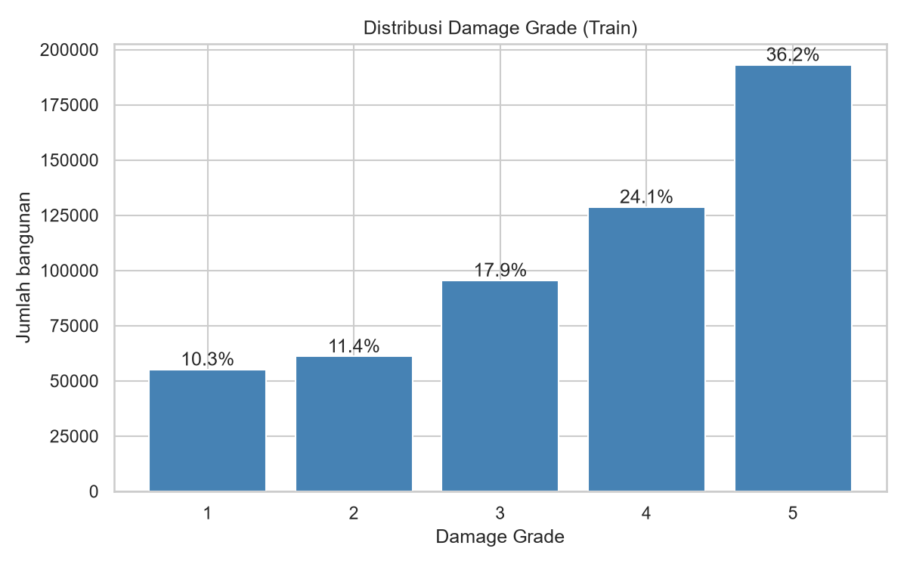
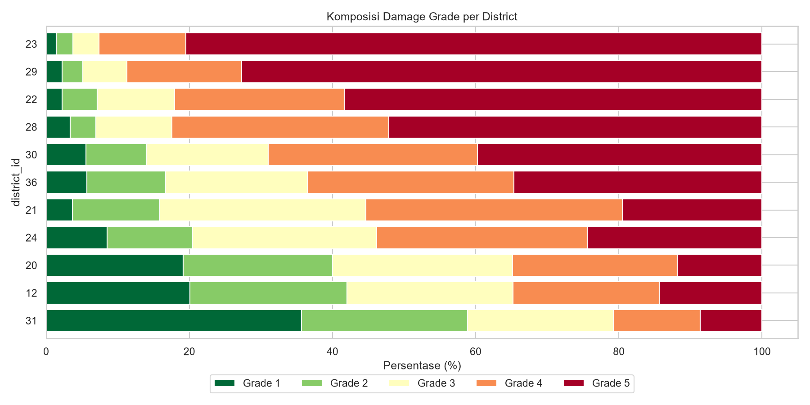
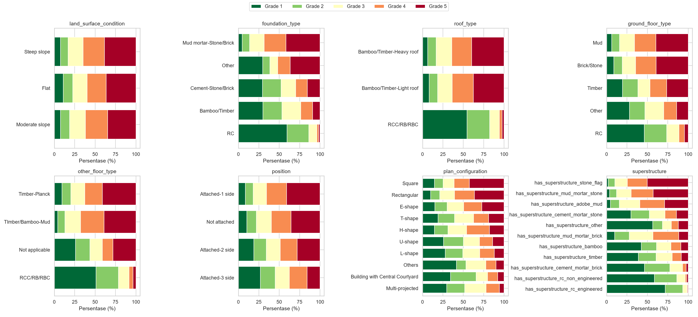
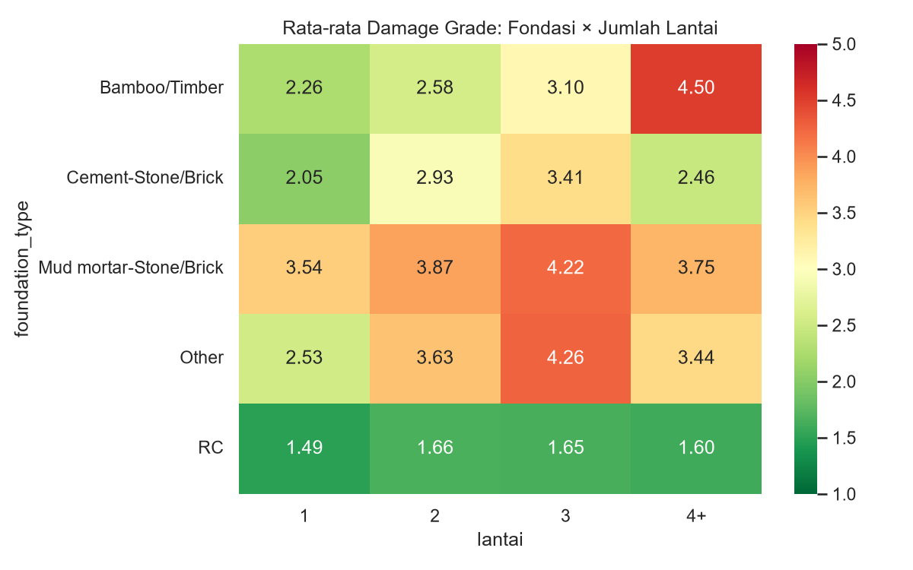
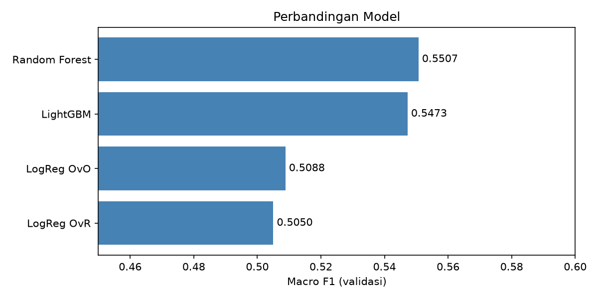
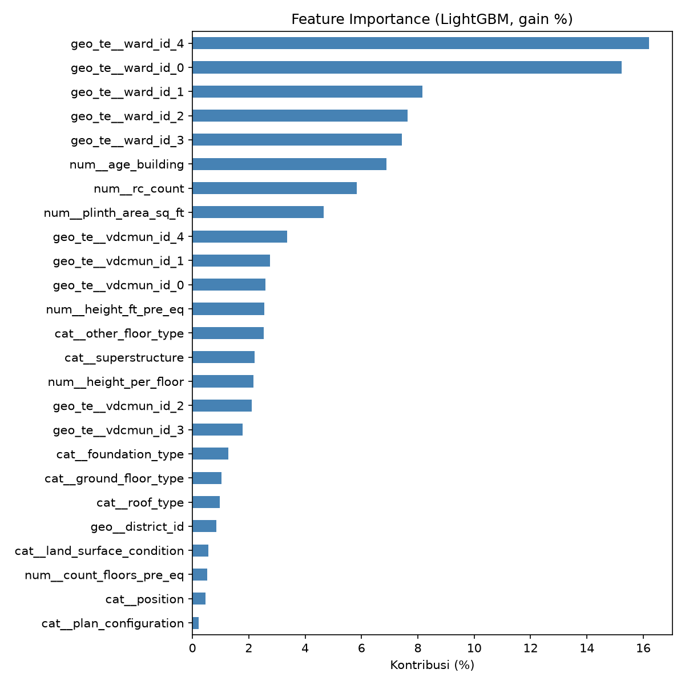
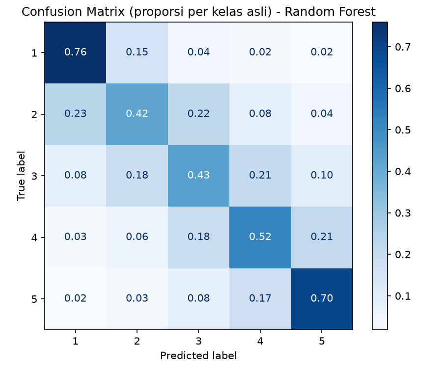

# Structural Damage Classification

Repository ini berisi pengerjaan Tugas 1 Supervised Machine Learning, yaitu kompetisi Kaggle [Structural Damage Classification](https://www.kaggle.com/t/a9196b92680b4492aeb06aeaee94f654). Tujuannya memprediksi tingkat kerusakan bangunan (`damage_grade` 1–5) akibat gempa Gorkha, Nepal, 25 April 2015, berdasarkan kondisi bangunan sebelum gempa. Evaluasi menggunakan Macro F1-Score.

Model akhir yang saya pakai adalah gabungan Random Forest dan LightGBM dengan penyesuaian bobot kelas. Skor Macro F1 di data validasi 0,5563 dan di public leaderboard 0,56232 (akun Kaggle: 009_Violita).

## Alur Kerja

1. **EDA** (`01_eda.ipynb`): memahami struktur data, kualitas data, distribusi target, hubungan fitur dengan target, serta perbandingan train dan test. Hasilnya berupa daftar keputusan preprocessing.
2. **Pipeline** (`scripts/`): keputusan dari EDA dituangkan ke transformer dan `ColumnTransformer`, lalu dirangkai dalam `Pipeline`.
3. **Modeling** (`02_modeling.ipynb`): baseline Logistic Regression (OvR dan OvO), Random Forest, LightGBM, tuning, ensemble, optimasi bobot kelas, dan eksperimen lanjutan.
4. **Submission** (`03_submission.ipynb`): prediksi data test dan pengecekan format sebelum diunggah ke Kaggle.

## Isi Repository

```
Structural-Damage-Classification/
├── README.md
├── .gitignore
├── requirements.txt
├── data/                      # tempat dataset Kaggle (tidak di-commit)
├── notebooks/
│   ├── 01_eda.ipynb           # eksplorasi data
│   ├── 02_modeling.ipynb      # pipeline, perbandingan model, model final
│   └── 03_submission.ipynb    # prediksi data test
├── scripts/
│   ├── __init__.py
│   ├── config.py              # path, parameter, daftar kolom
│   ├── preprocess.py          # load data dan ColumnTransformer
│   ├── feature_engineering.py # pembuatan fitur baru
│   ├── train.py               # pipeline dan model final
│   ├── evaluate.py            # evaluasi dan optimasi bobot kelas
│   └── predict.py             # pembuatan file submission
├── models/                    # model .pkl (tidak di-commit, ukurannya >1 GB)
├── submissions/
│   ├── submission.csv         # versi 1
│   └── submission_v2.csv      # versi final
└── reports/figures/           # grafik hasil EDA dan evaluasi
```

Folder `data/` dan `models/` sengaja dikosongkan di GitHub karena ukuran filenya besar.

### Isi folder `scripts/`

Setiap fungsi dan class di folder ini dilengkapi docstring.

| File | Fungsi / class utama | Kegunaan |
|---|---|---|
| `config.py` | – | Path folder, `RANDOM_STATE`, daftar kolom per kelompok, kode nilai tidak valid |
| `preprocess.py` | `load_data`, `split_xy`, `InvalidValueReplacer`, `build_preprocessor` | Membaca data, memisahkan X dan y, mengganti kode tidak valid, membangun `ColumnTransformer` |
| `feature_engineering.py` | `FeatureEngineer`, `GroupAggregator` | Membuat `height_per_floor` dan `rc_count`; fitur rata-rata per wilayah (eksperimen) |
| `train.py` | `build_pipeline`, `WeightedProbaClassifier`, `build_final_model` | Merangkai pipeline lengkap dan model final ensemble dengan bobot kelas |
| `evaluate.py` | `evaluate_model`, `optimize_class_weights` | Menghitung Macro F1, classification report, confusion matrix, dan mencari bobot kelas terbaik |
| `predict.py` | `load_model`, `make_submission` | Memuat model dan membuat file submission |

## Cara Menjalankan

**1. Clone repository dan masuk ke foldernya**

```bash
git clone https://github.com/Violita-archive/Structural-Damage-Classification.git
cd Structural-Damage-Classification
```

**2. Siapkan environment**

Proyek ini dikerjakan dengan Python 3.12.

```bash
python -m venv .venv
.venv\Scripts\activate          # Windows
source .venv/bin/activate       # macOS / Linux
pip install -r requirements.txt
```

**3. Unduh data**

Dataset diambil dari halaman kompetisi Kaggle. Setelah join competition, buka tab *Data*, klik *Download All*, lalu ekstrak keempat file (`train.csv`, `test.csv`, `sample_submission.csv`, `metadata.csv`) ke dalam folder `data/`.

Kalau sudah memakai Kaggle API, bisa juga lewat terminal:

```bash
kaggle competitions download -c structural-damage-classification -p data/
```

**4. Jalankan notebook berurutan**

Notebook dijalankan dari `01_eda` sampai `03_submission` dengan kernel `.venv`. Notebook `02_modeling` akan menyimpan model final ke `models/pipeline_model_v2.pkl` (proses pelatihannya sekitar 6–10 menit di laptop saya), lalu `03_submission` memakai model tersebut untuk membuat file submission.

**5. Membuat submission tanpa notebook**

Kalau model sudah tersimpan di `models/`, submission bisa langsung dibuat dari root repository:

```bash
python -m scripts.predict
```

Hasilnya tersimpan di `submissions/submission_v2.csv`.

## Tentang Data

Data train berisi 533.465 bangunan dan data test 228.629 bangunan. Fitur yang tersedia terbagi menjadi empat kelompok:

- **Lokasi**: `district_id` (11 kode), `vdcmun_id` (110 kode), `ward_id` (945 kode)
- **Numerik**: jumlah lantai, umur bangunan, luas plinth, dan tinggi bangunan sebelum gempa
- **Kategorik**: kondisi lahan, tipe fondasi, atap, lantai dasar, lantai lain, posisi, denah, dan material struktur utama (`superstructure`)
- **Target**: `damage_grade`, berupa teks "Grade 1" sampai "Grade 5"

Satu hal yang perlu dicatat, `metadata.csv` menyebut 11 kolom biner `has_superstructure_*`, tetapi di data kompetisi kolom-kolom itu sudah digabung menjadi satu kolom `superstructure`. Setelah dicek, setiap bangunan hanya punya satu material, jadi kolom ini diperlakukan sebagai kategorik biasa.

## Hasil EDA

Analisis lengkapnya ada di `notebooks/01_eda.ipynb`. Berikut temuan yang paling berpengaruh ke keputusan modeling.

**Kualitas data.** Tidak ada missing value, tetapi ada dua kode yang tidak masuk akal. Umur bangunan 999 muncul di 2.198 bangunan (nilainya melompat langsung dari 200 ke 999), dan tinggi 99 ft muncul di 212 bangunan yang ternyata hanya 1–3 lantai. Keduanya dianggap sebagai data kosong. Selain itu ditemukan 10.695 kelompok bangunan yang fiturnya persis sama tetapi grade-nya berbeda. Artinya ada sebagian kesalahan prediksi yang memang tidak bisa dihindari.

**Target tidak seimbang.** Grade 5 mendominasi (36,2%), sedangkan Grade 1 hanya 10,3%. Model yang selalu menebak Grade 5 saja sudah mendapat akurasi 36%, itulah kenapa Macro F1 lebih tepat dipakai.



**Lokasi sangat menentukan.** Rata-rata grade antar district berbeda jauh, dari 2,35 di district 31 sampai 4,68 di district 23, di mana lebih dari 80% bangunannya rusak total. Di dalam satu district pun variasinya masih besar, misalnya di district 12 rata-rata per municipality berkisar 2,13–3,77. Karena itu ketiga kolom lokasi tetap dipakai semua.



**Material bangunan.** Sekitar 80% bangunan masih memakai material tradisional (lumpur dan batu), dan kelompok inilah yang paling banyak rusak berat. Sebaliknya, bangunan beton bertulang (RC) hampir tidak ada yang mencapai Grade 5.



**Ada interaksi antar fitur.** Efek jumlah lantai ternyata bergantung pada jenis fondasi. Pada fondasi RC, rata-rata grade tetap di kisaran 1,5–1,7 berapa pun lantainya. Pada fondasi bambu/kayu, rata-ratanya naik dari 2,26 (1 lantai) menjadi 4,50 (4 lantai ke atas). Temuan ini jadi alasan saya mengutamakan model berbasis pohon.



**Train dan test mirip.** Selisih proporsi kategori antara train dan test paling besar hanya 0,19 poin persen, sehingga skor validasi bisa dipakai untuk memperkirakan skor leaderboard.

## Preprocessing

Semua langkah preprocessing dimasukkan ke dalam satu `Pipeline` supaya perlakuannya sama persis di data latih, data validasi, dan data test:

```
InvalidValueReplacer → FeatureEngineer → ColumnTransformer → model
```

`InvalidValueReplacer` mengubah umur 999 dan tinggi 99 menjadi NaN. `FeatureEngineer` menambahkan dua fitur baru: `height_per_floor` (tinggi dibagi jumlah lantai) dan `rc_count` (berapa komponen bangunan yang berbahan RC, nilainya 0–5). Ide `rc_count` muncul dari EDA, karena kolom-kolom material saling berkaitan dan sama-sama menggambarkan seberapa modern sebuah bangunan.

`ColumnTransformer` dibuat dalam dua versi:

| | Untuk Logistic Regression | Untuk Random Forest dan LightGBM |
|---|---|---|
| Numerik | imputasi median, log1p, StandardScaler | imputasi median |
| Kategorik | OneHotEncoder | OrdinalEncoder |
| `district_id` | OneHotEncoder | dipakai langsung |
| `vdcmun_id`, `ward_id` | TargetEncoder | TargetEncoder |

`ward_id` memakai TargetEncoder karena jumlah kodenya 945. Kalau di-one-hot akan muncul 945 kolom baru. TargetEncoder di sklearn sudah memakai cross-fitting, jadi aman dari leakage selama dipasang di dalam pipeline.

Outlier dan data duplikat tidak dibuang karena semuanya bangunan nyata, dan data test juga pasti berisi kasus serupa.

Beberapa hal yang saya perhatikan supaya tidak terjadi leakage:
- Semua fitur menggambarkan kondisi sebelum gempa, tidak ada kolom yang berisi informasi setelah gempa.
- `building_id` tidak dipakai sebagai fitur, hanya untuk file submission.
- Imputasi, scaling, dan target encoding di-fit di dalam pipeline, sehingga hanya belajar dari data latih pada setiap fold.
- Saat tuning, yang di-tuning adalah seluruh pipeline (parameter diberi awalan `model__`), sehingga preprocessing ikut di-fit ulang di setiap fold.

## Modeling

Untuk membandingkan model, data train dibagi 80% latih dan 20% validasi secara stratified. Hasilnya:

| Model | Macro F1 | Akurasi |
|---|---|---|
| Logistic Regression OvR | 0,5050 | 0,5441 |
| Logistic Regression OvO | 0,5088 | 0,5408 |
| LightGBM hasil tuning | 0,5401 | 0,5668 |
| LightGBM | 0,5473 | 0,5737 |
| Random Forest | 0,5507 | 0,5808 |



Setelah itu ada beberapa percobaan perbaikan:

1. **Tuning LightGBM** dengan RandomizedSearchCV (15 kombinasi, 3-fold). Karena keterbatasan waktu, tuning dijalankan di sampel 100 ribu baris dan memakan 53 menit. Hasilnya malah turun saat dipakai di data penuh, jadi tidak dipakai.
2. **Menggabungkan RF dan LightGBM** (rata-rata probabilitas), lalu **mengatur bobot tiap kelas** supaya Macro F1 maksimal. Bobot dicari di separuh data validasi dan diuji di separuh lainnya, agar skornya tidak terlalu optimis. Versi ini menjadi submission pertama (public 0,56169).
3. **LightGBM tanpa `class_weight="balanced"` dengan early stopping.** Pelatihan berhenti otomatis di pohon ke-391 dan hanya butuh 2,7 menit. Versi ini menjadi model final (public 0,56232).
4. **Menambah fitur rata-rata per wilayah** (umur, `rc_count`, jumlah lantai, luas, dan jumlah bangunan per ward dan municipality). LightGBM-nya sedikit membaik, tetapi setelah digabung dengan RF skornya sama dengan versi 3, jadi tidak dipakai.

Model final disimpan di `models/pipeline_model_v2.pkl` dan dilatih ulang memakai seluruh data train.

## Interpretasi

### Faktor yang paling berpengaruh



Berdasarkan gain LightGBM, kelompok fitur lokasi menyumbang 68,1% kontribusi model, fitur numerik 22,6%, dan fitur kategorik 9,3%. Hampir semua kontribusi lokasi berasal dari `ward_id`. Saya menduga ini berkaitan dengan jarak ke pusat gempa dan kondisi tanah di tiap wilayah, yang memang tidak tercatat langsung di data. Hasil ini sejalan dengan EDA, di mana `ward_id` punya hubungan paling kuat dengan target (Cramér's V 0,45).

Di luar lokasi, fitur bangunan yang paling berpengaruh adalah umur (6,9%) dan `rc_count` (5,8%). Bangunan yang lebih tua cenderung rusak lebih parah: median umurnya 7 tahun di Grade 1 dan 20 tahun di Grade 4–5. Fitur `rc_count` yang dibuat sendiri ternyata cukup berguna. Karena informasinya sudah merangkum kolom-kolom material, kontribusi masing-masing kolom material aslinya jadi kecil.

Kondisi lahan, posisi bangunan, dan bentuk denah hampir tidak berpengaruh (masing-masing di bawah 0,6%). Ini juga sudah terlihat di EDA: komposisi grade di lahan datar, landai, dan curam hampir sama.

### Kelas yang sulit diprediksi



Grade 1 dan Grade 5 paling mudah ditebak (F1 sekitar 0,66 dan 0,73) karena berada di ujung skala. Awalnya saya mengira Grade 4 dan 5 yang paling sulit karena karakteristiknya mirip di EDA. Ternyata yang paling sulit justru Grade 2 (F1 sekitar 0,40), yang sering tertukar ke Grade 1 maupun Grade 3. Grade 4 dan 5 memang saling tertukar, tetapi tidak separah itu (sekitar 20%).

Hampir semua kesalahan terjadi ke grade yang bersebelahan. Bangunan Grade 1 yang ditebak Grade 5 hanya sekitar 2%, jadi model sudah menangkap urutan tingkat kerusakan dengan cukup baik.

### OvR vs OvO dan pilihan model

Pada Logistic Regression, OvO sedikit lebih baik dari OvR (0,5088 vs 0,5050). Perbedaannya paling terlihat di Grade 2 (recall naik dari 0,32 ke 0,37), sesuai teori bahwa OvO lebih cocok untuk kelas yang saling tumpang tindih. OvO juga lebih cepat (27 vs 67 detik) karena tiap model biner hanya dilatih pada data dua kelas.

Model berbasis pohon unggul sekitar 0,04 dari Logistic Regression. Ini masuk akal karena model pohon bisa menangkap interaksi seperti fondasi × jumlah lantai, sedangkan model linear tidak.

### Soal bobot kelas

Pada model awal, `class_weight="balanced"` membuat Grade 1 terlalu sering ditebak (recall 0,76 tetapi precision hanya 0,59). Karena itu di versi final, bobot otomatis tersebut dilepas dan diganti dengan bobot yang dicari langsung untuk memaksimalkan Macro F1. Efeknya terlihat di distribusi prediksi test: Grade 2 diprediksi 15,2% (di train 11,4%) dan Grade 5 diprediksi 32,2% (di train 36,2%). Pergeseran ini sengaja dibiarkan, karena Macro F1 memberi bobot yang sama untuk setiap kelas.

## Keterbatasan

- Tuning hanya dilakukan di subsampel karena waktu komputasi di laptop terbatas. Tuning di data penuh mungkin memberi hasil berbeda.
- Perbandingan model memakai satu kali split holdout, bukan cross-validation penuh.
- Beberapa percobaan terakhir hanya memberi selisih sekitar 0,001, sehingga performa tampaknya sudah mentok di kisaran 0,556 (validasi). Kemungkinan ini dipengaruhi banyaknya bangunan dengan fitur identik tetapi grade berbeda.
- Ukuran model final besar (lebih dari 1 GB), terutama karena Random Forest.

Untuk pengembangan berikutnya, data tambahan seperti jarak ke episentrum atau intensitas guncangan per wilayah kemungkinan lebih membantu dibanding mengutak-atik model. Pendekatan yang memanfaatkan sifat ordinal target, misalnya regresi dengan threshold, juga layak dicoba.

## Penulis

Violita Karina Putri – 5052241009
Institut Teknologi Sepuluh Nopember
